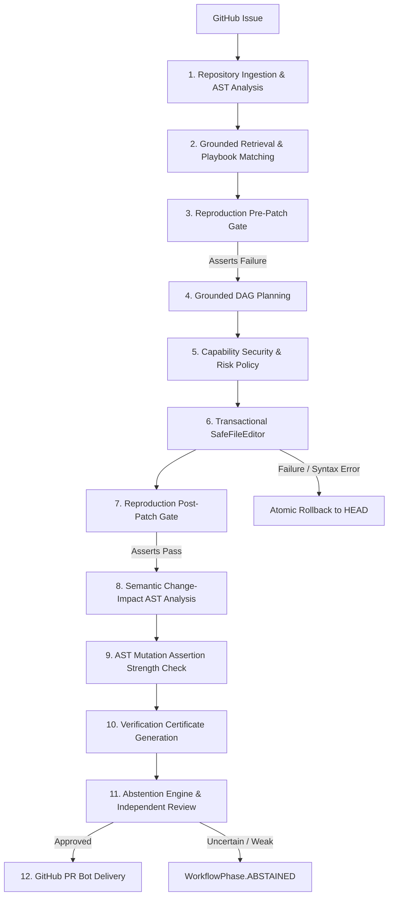

# QuetZ (Autonomous Software Engineer) — Architectural Whitepaper

> *Named after Quetzalcoatl, the Mesoamerican deity of wisdom, learning, and wind.*

**A Verifiable, Fail-Closed Autonomous Agent Harness for Software Engineering Tasks**

---

## 1. Core Thesis & Design Philosophy

Current LLM agent harnesses for software engineering suffer from three fundamental vulnerabilities:
1. **Unconstrained Swarm Drift**: Agents spawned in open-ended multi-agent graphs lack deterministic rollback and cryptographic verification.
2. **Vacuous / Tautological Patching**: Agents routinely write tests that pass regardless of bug presence, producing falsely green CI runs.
3. **Unbounded Mutation**: Agents modify source code without provenance anchors, leading to corrupted files, hallucinations, and syntax breakage.

QuetZ solves this through a **fail-closed, proof-carrying architecture**:
- **Deterministic Sandboxing**: All mutations occur within isolated workspace checkouts; any test failure, policy violation, or parse error triggers an immediate, transactional rollback.
- **Epistemic Humility (Formal Abstention)**: When evidence is sparse or verification is inconclusive, QuetZ explicitly transitions to `WorkflowPhase.ABSTAINED` rather than submitting a speculative patch.
- **Proof-Carrying Verification**: Every resolution is certified by an immutable `VerificationCertificate` carrying SHA256 evidence digests.

---

## 2. Multi-Tier System Architecture



---

## 3. Core Subsystems

### 3.1 Security & Capability Authorization (`execution/models.py`)
Operations are restricted to strictly typed capability grants:
- `CAP_READ_REPO`: Read workspace files and AST tables.
- `CAP_WRITE_SOURCE`: Modify existing codebase files under 4-tier anchors.
- `CAP_CREATE_FILE`: Create new source or test modules.
- `CAP_RUN_TEST`: Execute allowlisted test runners (`pytest`, `python -m pytest`).
- `CAP_OPEN_PR`: Submit pull requests to GitHub.

Risk levels range monotonically from `R0_READ_ONLY` to `R5_PRODUCTION_IMPACT`. Actions exceeding policy ceilings are rejected immediately.

### 3.2 4-Tier Fuzzy Anchor Resolution (`execution/file_editor.py`)
Code edits do not rely on line numbers:
- **Tier 1**: Exact byte-for-byte substring match.
- **Tier 2**: Normalized indentation and line-ending match.
- **Tier 3**: Symbol-scoped AST match (scoped to the enclosing function/class).
- **Tier 4**: Token-level fuzzy anchor matching with strict uniqueness and `>= 0.85` similarity ratio.

### 3.3 Semantic Change-Impact Analyzer (`repository/impact_analyzer.py`)
Constructs an AST reverse-import graph across the entire repository:
- Tracks direct and transitive callers (up to depth $N$).
- Computes a normalized **Blast Radius Score** ($[0.0, 1.0]$).
- Prioritizes targeted test suites based on reverse call-graph proximity.

### 3.4 Reproduction-Before-Fix Engine (`verification/reproduction.py`)
- Enforces the scientific method: candidate reproduction tests **must fail** on the unpatched codebase.
- Rejects vacuous or tautological tests (`VACUOUS_PRE_PATCH`).
- Asserts that the exact same test passes cleanly post-patch (`CONFIRMED_REPRODUCED`).

### 3.5 Mutation-Based Assertion Strength Checker (`verification/mutation.py`)
- Injects controlled syntactic AST mutations (operator inversion, boolean flipping, constant offsets).
- Measures the test suite's sensitivity: mutants must be caught and "killed".
- Generates a quantified `mutation_score`.

### 3.6 Formal Evidence-Based Abstention (`agents/validator.py`)
ASE computes a weighted multi-dimensional confidence score:
$$\text{Confidence} = 0.30 \cdot S_{\text{grounding}} + 0.25 \cdot S_{\text{plan}} + 0.35 \cdot S_{\text{verification}} + 0.10 \cdot S_{\text{authority}}$$
If confidence falls below threshold or unverified behavior is detected, the run formally abstains.

---

## 4. Verification Certificate & Audit Trail

Every successful run produces a tamper-evident `VerificationCertificate`:
```markdown
# QuetZ Verification Certificate
- Certificate ID: `cert-8f92-411a`
- Status: `COMPLETED`
- Confidence Score: `0.95`
- Static AST Validation: `PASS`
- Dynamic Test Verification: `PASS`
- Evidence Digest: `sha256:4a7e9102...`
```

---

## 5. Developer & Production Interfaces
- **CLI**: `python -m autonomous_engineer run --repo <path> --title <title> --body <body>`
- **Audit**: `python -m autonomous_engineer audit`
- **Playbooks**: `python -m autonomous_engineer skills`
- **PR Bot**: `autonomous_engineer.github.GitHubPRBot`
- **Benchmark Runner**: `scripts/run_pipeline_benchmark.py`
