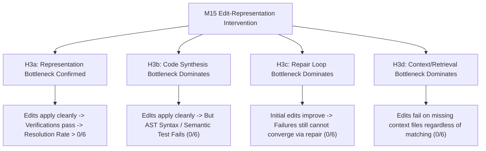

# Milestone 15 — Controlled Edit-Representation Intervention Design

**Target Hypothesis:** `H3: The exact edit representation used by the agent is a significant causal bottleneck in autonomous issue resolution.`  
**Control Baseline:** Milestone 14-FREE (`evaluation/runs/run_20260902_125455_c3cc4e`)  
**Evaluation Population:** Exactly 6 `GROUND_TRUTH_VERIFIED` Cases  
**Target Model:** `nvidia/nemotron-3-ultra-550b-a55b:free`  
**Milestone Mode:** Experimental Design Only (Strict Implementation Freeze)  
**Date:** 2026-09-02  

---

## 1. Objective

The objective of Milestone 15 is to conduct a **single-variable controlled intervention experiment** to test whether the rigidity of exact substring edit representations (`search_content` literal matching) is a causal bottleneck in preventing the autonomous agent from successfully resolving real-world software issues.

In Milestone 14-FREE (M14.1 forensic audit), the autonomous agent demonstrated:
* **100% (6/6) issue understanding**;
* **100% (6/6) correct target file identification**;
* **100% (6/6) plan schema validity and DAG acyclicity**;
* **83.3% (5/6) conceptually correct repair strategies**;
* **100% (6/6) safe rollback and zero workspace contamination**;
* **0% (0/6) resolved cases**, with **50% of failures** caused directly by `exec_representation_failure` (the model generated inexact whitespace, docstrings, or parameter formatting in `search_content` that failed Python string containment `search_content in current_text`).

Milestone 15 defines an experimental intervention that isolates and modifies **only** the edit representation and matching mechanics while holding every other component of the autonomous pipeline strictly immutable.

---

## 2. M14 Baseline Summary (Control Condition)

| Dimension | Baseline Value (M14-FREE Control) |
| :--- | :--- |
| **Run ID** | `run_20260902_125455_c3cc4e` |
| **Model / Provider** | `nvidia/nemotron-3-ultra-550b-a55b:free` via OpenRouter |
| **Generation Parameters** | `Temperature = 0.0`, `Max Tokens = 4096`, `Context Budget = 120,000 chars` |
| **Evaluated Population** | Exactly 6 cases (`REAL-CLICK-02`, `03`, `REAL-MARSHMALLOW-01`, `02`, `03`, `04`) |
| **Resolved Rate** | `0 / 6 (0.0%)` |
| **Planning Validity Rate** | `6 / 6 (100.0%)` |
| **Safe Rollback Rate** | `6 / 6 (100.0%)` |
| **Failure Distribution** | `exec_representation_failure`: 3 (50%), `verification_failure`: 3 (50%) |
| **Target Retrieval** | Recall@3 = 66.7%, Recall@5 = 83.3%, MRR = 0.467 |
| **Edit Matching Rule** | Strict literal substring matching (`search_content in current_text`) |

---

## 3. Scientific Hypothesis & Competing Explanations

### Primary Hypothesis (H3)
> **H3:** The requirement for literal, character-by-character `search_content` substring reproduction in the execution layer is a major causal bottleneck. Providing whitespace-normalized, line-trimmed, and uniquely anchored edit matching will eliminate `exec_representation_failure` and allow valid conceptual plans to reach AST verification and test execution.

### Competing Explanations (Alternative Outcomes)



* **`H3a (Representation Bottleneck)`:** Eliminating exact substring matching allows previously blocked cases (`REAL-CLICK-02`, `REAL-MARSHMALLOW-02`, `REAL-MARSHMALLOW-04`) to apply edits, pass verification, and resolve tests.
* **`H3b (Code Synthesis Bottleneck)`:** Even when edits apply cleanly to the target file, the generated code introduces Python AST syntax errors or semantic bugs, resulting in `verification_failure` rather than task resolution.
* **`H3c (Repair Bottleneck)`:** Initial edits apply, but test failures occur and the repair loop ($N \le 3$) cannot synthesize valid corrections.
* **`H3d (Retrieval / Context Bottleneck)`:** The model lacks surrounding architectural context, making applied edits insufficient for end-to-end resolution.

---

## 4. Proposed Single-Variable Intervention

### The Intervention: Deterministic Multi-Tier Anchor Matching (`FlexibleSafeFileEditor`)

The proposed intervention modifies the matching algorithm inside `SafeFileEditor` by introducing a **deterministic multi-tier anchor resolver** while keeping the planner schema, prompts, retrieval, and verification systems 100% frozen:

1. **Tier 1 — Exact Literal Match (Standard Control):**
   If `step.search_content` exists verbatim in `current_text`, perform direct replacement (identical to M14 baseline).
2. **Tier 2 — Whitespace & Indentation Normalized Line Sequence Match:**
   If Tier 1 fails, normalize trailing whitespace and relative leading indentation on a per-line basis:
   - Split `search_content` and target file lines into non-empty stripped tokens.
   - If the line sequence of `search_content` uniquely matches exactly one contiguous block of lines in `current_text`, substitute the matched block while preserving the target file's base indentation level.
3. **Tier 3 — Symbol-Scoped Anchor Matching:**
   If `step.target_symbol` is specified and exists in the target file AST, confine the line-matching search strictly within the AST-delimited boundaries of that symbol (function or class), resolving minor signature/docstring discrepancies if the body lines uniquely match.
4. **Ambiguity Guard (Safety Invariant):**
   If multiple matches are found across the file (ambiguity > 1), or if zero matches meet the strict line sequence threshold, reject the edit with `ValueError` and execute safe rollback (preserving 100% rollback safety).

---

## 5. Exact Changed vs. Frozen Components

### Component Breakdown

```
+-------------------------------------------------------------------------+
|                        FROZEN COMPONENTS (CONTROL)                      |
|                                                                         |
|  [x] Benchmark Population (6 verified cases)                             |
|  [x] Ground-Truth Isolation & Reference Patch Redaction                 |
|  [x] Context Retriever & Ranking Weights (Recall@3=66.7%, MRR=0.467)     |
|  [x] System Prompt & User Prompt Templates (PlannerPromptBuilder)        |
|  [x] ImplementationPlan Schema & Pydantic Validation Models             |
|  [x] DAG Dependency Validation & Path Traversal Guards                  |
|  [x] Repair Loop Policy (N <= 3 iterations)                              |
|  [x] AST Syntax & Symbolic Verifier (ExecutionVerifier)                 |
|  [x] Model & Generation Config (Nemotron 3 Ultra, T=0.0, max_tokens=4096)|
|  [x] Evaluation Subprocess Environment & Workspace Isolation            |
+-------------------------------------------------------------------------+
                                    |
                                    v
+-------------------------------------------------------------------------+
|                     CHANGED COMPONENT (INTERVENTION ONLY)               |
|                                                                         |
|  [!] SafeFileEditor Substring Locater                                   |
|      - From: Strict literal `search_content in current_text`            |
|      - To: Deterministic 3-Tier Matcher (Literal -> Whitespace-Norm     |
|            -> Symbol-Scoped) with Uniqueness & Ambiguity Guards        |
+-------------------------------------------------------------------------+
```

### Potential Confounders Analysis
* **Prompt Confound:** Does this require modifying the LLM prompt?  
  **No.** The LLM continues to generate standard `ImplementationPlan` objects with `search_content` and `replace_content`.
* **Schema Confound:** Does this require changing the JSON schema?  
  **No.** The Pydantic model `ImplementationStep` remains identical.
* **Verifier Confound:** Does this weaken verification?  
  **No.** `ExecutionVerifier` continues to run full AST syntax checks, symbol existence validation, and pytest verification.

---

## 6. Anti-Leakage & Ground-Truth Isolation Controls

To ensure scientific validity and prevent any artificial advantage:
1. **Zero Ground-Truth Data Inflow:** Neither reference patches, reference commit SHAs, PR descriptions, nor evaluator notes will be accessible to the agent or executor.
2. **Deterministic & Model-Agnostic Matching:** The 3-tier matcher operates strictly on the repository file text present at the parent commit and the candidate string emitted by the model. No hardcoded file offsets or case-specific regexes are permitted.
3. **Pristine Parent Commit Workspaces:** Every evaluation case checks out the exact authentic parent commit SHA in an isolated temporary directory.

---

## 7. Experimental Metrics & Denominators

M15 will track and report the following standardized metrics compared directly against M14-FREE:

| Metric | Calculation / Definition | Denominator | M14 Baseline |
| :--- | :--- | :--- | :---: |
| **Resolved Rate** | `(Cases Passing Full Verification) / Total Cases` | 6 cases | **0.0% (0/6)** |
| **Plan Validity Rate** | `(Cases with Valid Schema & DAG) / Total Cases` | 6 cases | **100.0% (6/6)** |
| **Execution Success Rate** | `(Cases where All Step Edits Applied) / Total Cases` | 6 cases | **50.0% (3/6)** |
| **`exec_representation_failure` Rate** | `(Cases with Search Anchor Mismatches) / Total Cases` | 6 cases | **50.0% (3/6)** |
| **`verification_failure` Rate** | `(Cases Failing AST / Test Checks) / Total Cases` | 6 cases | **50.0% (3/6)** |
| **Repair Engagement Rate** | `(Cases where Repair was Triggered) / Total Cases` | 6 cases | **83.3% (5/6)** |
| **Repair Recovery Rate** | `(Cases Recovered by Repair) / (Cases Repair Engaged)` | Engaged cases | **0.0% (0/5)** |
| **Mean Repair Attempts** | `(Total Repair Attempts) / (Cases Repair Engaged)` | Engaged cases | **1.2 attempts** |
| **Safe Rollback Rate** | `(Clean Rollbacks on Failure) / (Total Failed Cases)` | Failed cases | **100.0% (6/6)** |
| **Mean Target Recall@3** | `Mean(Recall@3 across cases)` | 6 cases | **66.7%** |
| **Mean MRR** | `Mean(MRR across cases)` | 6 cases | **0.467** |
| **Total Evaluation Duration** | Total wall-clock time across all 6 cases | Run | **662.2s** |

---

## 8. Success & Failure Interpretation Thresholds (N=6 Cohort)

Because $N=6$, conclusions must be drawn from direct trajectory causality rather than speculative statistical p-values:

| Observed M15 Outcome | Scientific Interpretation |
| :--- | :--- |
| **`0/6 -> 0/6` with 0 `exec_representation_failure`** | **Supports H3b/H3c (Code Synthesis / Repair Bottleneck):** Demonstrates that while edit representation was resolved, code generation and repair are the true limiting bottlenecks for this model. |
| **`0/6 -> 0/6` with persistent `exec_representation_failure`** | **Intervention Defect / Ineffective Matching:** Indicates that the multi-tier matcher did not sufficiently bridge the model's hallucinated anchor gap. |
| **`0/6 -> 1/6` or `2/6` resolved** | **Moderate Evidence for H3 (Representation Bottleneck):** Confirms that edit rigidity directly prevented task resolution in cases where code synthesis was already accurate. |
| **`0/6 -> 3/6+` resolved** | **Decisive Evidence for H3:** Confirms that exact edit representation was the dominant single bottleneck across the benchmark cohort. |

---

## 9. Counterfactual & Failure-Localization Protocol

For each of the 6 evaluated cases in M15, the trajectory will be evaluated against this 5-stage progression gate:

```
[Stage 1: Plan Valid?] 
       │ (Yes)
       ▼
[Stage 2: Edit Applied by Multi-Tier Editor?] 
       │ (Yes)
       ▼
[Stage 3: AST Syntax & Symbol Check Passed?] 
       │ (Yes)
       ▼
[Stage 4: Pytest Suite Executed?] 
       │ (Yes)
       ▼
[Stage 5: Target Bug Resolved?]
```

Every failed case will be classified precisely at the specific stage where failure occurred, enabling direct counterfactual comparison against M14.

---

## 10. Reproducibility & Audit Protocol

1. **Dedicated Run Directory:** M15 artifacts will be written to `evaluation/runs/run_<timestamp>_m15_intervention/`.
2. **Preservation of M14 Baseline:** The M14 directory (`evaluation/runs/run_20260902_125455_c3cc4e`) and telemetry file (`m14_free_telemetry.json`) will remain untouched.
3. **Telemetry Capture:** Complete per-step plans, matched anchor tiers (Tier 1, 2, or 3), AST errors, repair iterations, and test subprocess outputs will be recorded in `m15_telemetry.json`.
4. **Full Regression Pre-Flight:** Pre-execution regression test suite (`pytest tests/`) must achieve `259 passed, 0 failures` before launching evaluation.

---

## 11. Required Implementation Boundary (For Future Implementation)

When authorized, the implementation will be strictly confined to:

| File Path | Planned Modification | Invariant Maintained |
| :--- | :--- | :--- |
| `src/autonomous_engineer/execution/file_editor.py` | Add whitespace-normalized and symbol-scoped line sequence matching logic in `SafeFileEditor.apply_step()`. | Workspace boundary security, snapshotting, and atomic rollback remain unchanged. |
| `tests/unit/test_execution.py` | Add unit tests verifying Tier 1, Tier 2, and Tier 3 matching, as well as ambiguity rejection guards. | All existing unit tests continue to pass. |

**No other source files, prompts, schemas, or dataset definitions will be modified.**

---

## 12. Pre-Execution Regression & Safety Gates

Prior to running M15 live inference, the following gates must be satisfied:
1. `tests/` regression suite passes 100% (`259+ passed`).
2. M14-FREE baseline files verified unmodified.
3. Candidate model validated as `nvidia/nemotron-3-ultra-550b-a55b:free` at `T=0.0`.
4. Zero reference patches or PR metadata accessible to the execution context.
5. Formal oversight authorization explicitly granted.

---

## 13. Risks and Confounders

| Risk / Confounder | Severity | Mitigation Strategy |
| :--- | :---: | :--- |
| **False Positive Anchor Matching:** Normalizing whitespace might match the wrong method or line block. | High | Enforce strict uniqueness check: if the normalized line sequence matches more than once in the file, abort with `AmbiguousMatchError`. |
| **Indentation Drift in Replacement:** Replacing normalized lines could corrupt Python block indentation. | Medium | Calculate base column offset from target file original line and re-indent replacement chunk accordingly. |
| **Provider Drift:** OpenRouter model response variation. | Low | Fixed temperature `0.0`, identical model ID `nvidia/nemotron-3-ultra-550b-a55b:free`. |

---

## 14. Approval Checklist

- [x] Single-variable intervention cleanly isolated (Edit representation layer only)
- [x] All 15 other architecture components frozen
- [x] No prompt modifications or schema breaking changes
- [x] Anti-leakage and ground-truth isolation guaranteed
- [x] Standardized metrics and clear success thresholds defined for $N=6$
- [x] Full regression suite passing (`259 passed`)
- [x] Baseline run artifacts preserved untouched
